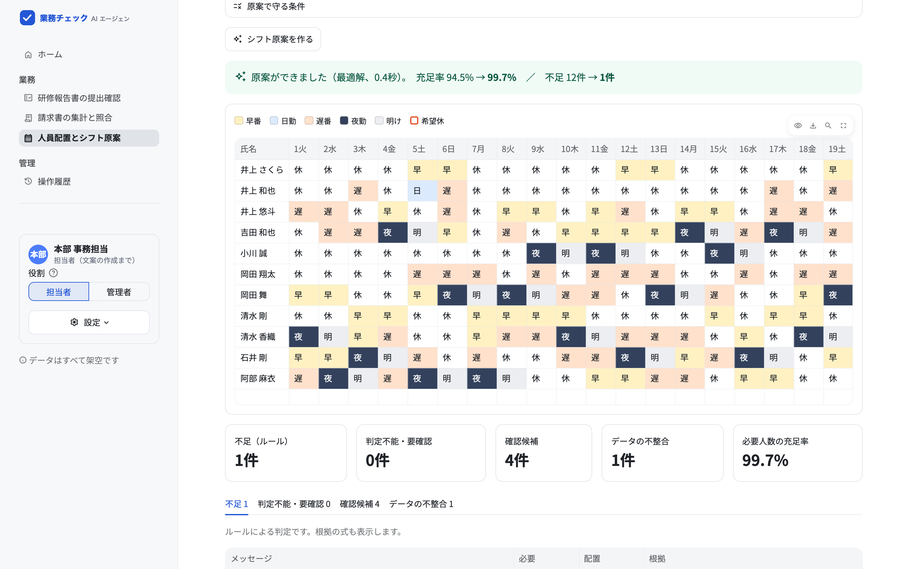
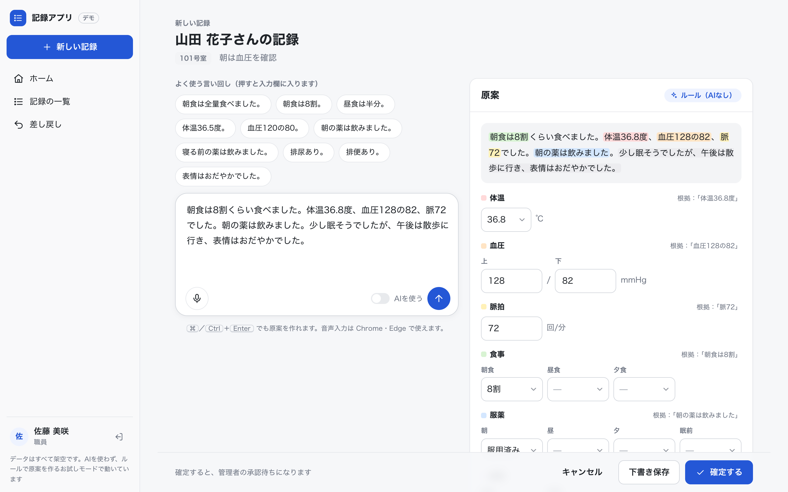
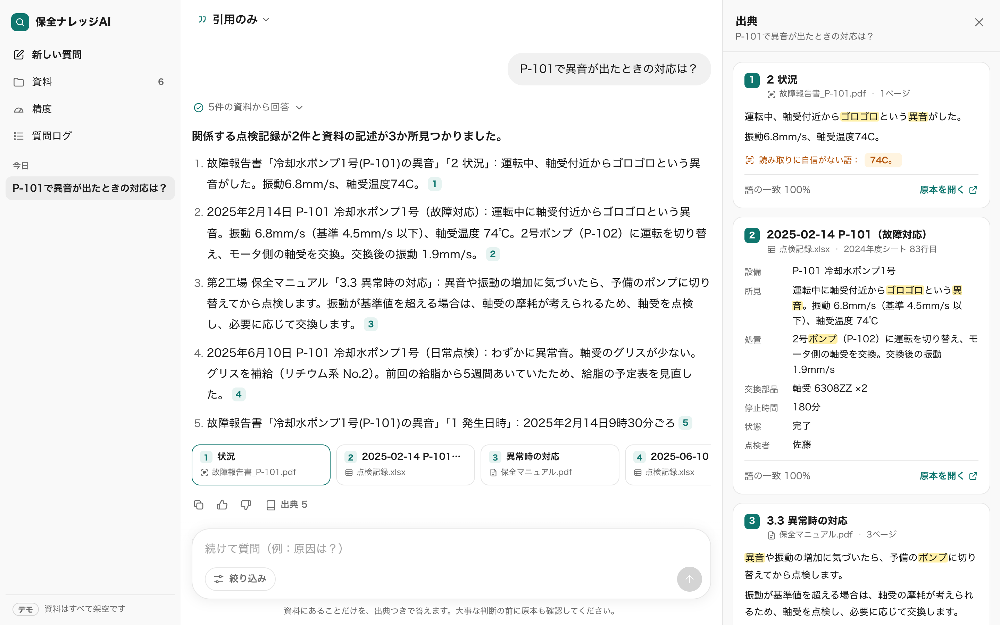

### こんにちは、Yuuuuu000（yutennnnn）です 

Python とデータ分析を軸に、業務の自動化や、生成AIを業務に組み込む仕事をしているフリーランスのデータサイエンティストです。

- 銀行での融資業務を経て、IT企業のデータサイエンティストとして、億件規模のデータ分析と、分析・推論パイプラインの自動化を担当
- 2026年11月現在は大手放送局の視聴データ分析、企業向けのデータサイエンス・生成AI研修の講師、Claude Code の導入支援、技術記事の執筆をしています

---

#### 🛠 公開しているデモ

| | |
|---|---|
|  | **[業務チェックAIエージェント](https://github.com/yutennnnn/gyomu-check-agent)** 介護・福祉の法人本部で手作業になりがちな突き合わせや集計、チェックを自動化するデモ。名簿とフォーム回答の突き合わせ、PDF請求書の照合と按分、人員配置のチェックとシフト原案（OR-Tools）。判定はルール、AIは文案と説明だけ。承認の流れ・操作履歴・ダークモードにも対応。 ▶ [デモを試す](https://yutennnnn-gyomu-check.onrender.com) `Python` `Streamlit` `pandas` `pdfplumber` `OR-Tools` `Claude API` |
|  | **[記録アプリ](https://github.com/yutennnnn/kiroku-app)** 音声やメモから支援記録の原案を作り、職員が確定して管理者が承認するまでを試せるWebアプリ。AIが出した項目は、根拠が元の発言に見つからなければ採用しない。権限・CSRF・操作履歴・Excel帳票。タブレット・スマホ・ダークモードにも対応。 ▶ [デモを試す](https://yutennnnn-kiroku.onrender.com) `FastAPI` `SQLAlchemy` `HTML/CSS` `JavaScript` `Claude API` `Docker` |
|  | **[保全ナレッジAI](https://github.com/yutennnnn/hozen-rag)** 工場の点検記録（Excel）・マニュアル（PDF）・スキャンした報告書・議事録から探して、出典つきで答える社内向けの検索AI（RAG）。資料にないことは「見つからない」と答える。調整に使っていない質問での正解率も公開。チャット型の画面で続けて質問でき、スマホ・ダークモードにも対応。 ▶ [デモを試す](https://yutennnnn-hozen.onrender.com) `FastAPI` `BM25` `Tesseract OCR` `Claude API (citations)` `Docker` |

名前を押すと説明のページ（画面写真・動画・設計の考え方）が、「デモを試す」を押すとブラウザで動くデモが開きます。どれも架空のデータで動き、APIキーは要りません。ソースコードは非公開です。
デモは、しばらく使われていないと最初の表示に1分ほどかかります。

#### 得意

- Excel・CSV・PDF を読み込んで、照合・集計・帳票づくりを自動化する
- 生成AIは事実判定には使わず、文案・説明・原案づくりに絞り、人による確認とあわせて業務に組み込む
- 社内の資料から出典つきで答える検索AI（RAG）を作り、正解を決めた質問で精度を測りながら改善する
- 大量データの集計・分析（SQL / PySpark / Databricks / BigQuery）と、定型レポートの自動作成
- Claude Code を使った開発と、その導入支援

#### 技術スタック

`Python` `SQL` `PySpark` `pandas` `scikit-learn` `FastAPI` `Streamlit` `SQLAlchemy` `Airflow` `Databricks` `AWS (EC2 / S3 / EKS / EMR / Redshift)` `BigQuery` `Docker` `Selenium` `Playwright` `OR-Tools` `Claude API` `OpenAI API` `Claude Code`

#### 執筆

- [Axross Recipe の執筆一覧](https://axross-recipe.com/users/60037)（Claude Code・Codex・AIエージェント・ローカルLLMなど30本以上）
